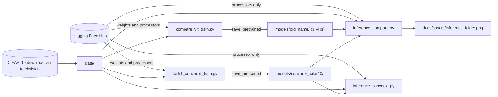

# vit-compare: documentation

vit-compare is four Python console scripts. They fine-tune three Vision Transformers
(`microsoft/cvt-21`, `microsoft/swin-base-patch4-window7-224`,
`google/vit-base-patch16-224-in21k`) and one ConvNext (`facebook/convnext-base-224-22k-1k`)
on CIFAR-10 for one epoch each, then measure training time, average loss, accuracy and
inference latency or throughput (`README.md:3-8`). The repository does not say who the
intended readers or users are; its history shows the scripts began as a course exercise
(the brief removed in `2833f98`; see [Open questions](../SPEC.md#9-open-questions)).

The requirements reverse-engineered from the code are in [`../SPEC.md`](../SPEC.md).

## Status

- Last commit that changed the project's own scripts: `a72605c`, 2026-11-08,
  "refactor(core): settle the sources under the pinned ruff and mypy". The scripts were
  first added on 2026-04-22 (`c76659b`, `6fd8613`). Tags: `v1.0.0`, `v1.1.0`; the version
  in `pyproject.toml:17` and `recipe.ps1:13` is `1.1.0`.
- Tests: 20 pytest functions in 6 files under `tests/`, run with fakes instead of real
  models, processors and CIFAR-10 (`tests/fake_vision_models_and_datasets.py:1`).
- CI: five Gitea Actions workflows in `.gitea/workflows/`; `test.yaml` runs on push to
  `test`, nightly at 03:00 and by hand, on a runner labelled `windows`
  (`.gitea/workflows/test.yaml:2-16`). There is no `.github/workflows/` directory.
- Evidently unfinished:
  - `tests/manual/tests.json` lists no manual tests (`"tests": []`).
  - The checkboxes under "Verification Criteria" in `docs/compare_vit_train.md:42-47`
    are all unticked.
  - `README.md:53` names five lab requirements the repository does not meet
    (R-02, R-09, R-37, R-41, R-42, issues #8 to #12 on the lab server).

## Layout

| Path | What it is |
| :--- | :--- |
| `compare_vit_train.py` | Fine-tunes the three ViTs one after another, saves them, prints a time and loss table |
| `task1_convnext_train.py` | Fine-tunes ConvNext-Base, validates it, saves it, prints a result table |
| `inference_compare.py` | Classifies one CIFAR-10 test image with every folder in `models/`, times it, draws the result into a PNG |
| `inference_convnext.py` | Runs the fine-tuned ConvNext over the whole CIFAR-10 test set, prints throughput and accuracy |
| `tests/` | pytest suite; `fake_vision_models_and_datasets.py` holds the stand-ins, `conftest.py` sets the Hub offline |
| `tests/manual/` | Manual-test list (`tests.json`, empty) and its page (`index.html`, `serve.py`, lab tooling) |
| `docs/install.md`, `docs/manual.md` | Install steps and what each script prints |
| `docs/compare_vit_train.md` | Implementation plan for `compare_vit_train.py`, from the first commit |
| `docs/assets/` | Three 448 x 448 PNGs written by `inference_compare.py`, stored in Git LFS (`.gitattributes:9`) |
| `pyproject.toml`, `uv.lock` | Dependency pins and tool settings; uv lock file |
| `.agent/`, `.vscode/` | Agent kit and editor settings from the first commit, not used by the scripts; excluded from ruff (`pyproject.toml:60`) |

## Architecture

There is no shared module: each script is standalone. Three of them repeat their own data
pipeline (`Resize` to the processor's `size["height"]` or 224, `ToTensor`, `Normalize` with
the processor's mean and std); `inference_compare.py` passes the image to the processor
itself (`inference_compare.py:63`). The scripts exchange data only through directories relative
to the working directory: `./data` (CIFAR-10), `./models` (fine-tuned weights) and
`./docs/assets` (images).

- External services: the Hugging Face Hub for pretrained weights and image processors
  (`AutoImageProcessor.from_pretrained`, `AutoModelForImageClassification.from_pretrained`)
  and the CIFAR-10 download of `torchvision.datasets.CIFAR10(download=True)`.
- Hardware: each script uses CUDA when `torch.cuda.is_available()`, the CPU otherwise
  (for example `compare_vit_train.py:168`). `task1_convnext_train.py` turns on autocast and
  `GradScaler` only on CUDA (`task1_convnext_train.py:139,154`).
- Only the model is saved (`compare_vit_train.py:154`, `task1_convnext_train.py:190`); the
  inference scripts load the processor again from the Hub by model id
  (`inference_compare.py:51-58`, `inference_convnext.py:29-31`).

## Build and run

Prerequisites:

- Python 3.13 (`pyproject.toml:22` requires `>=3.13,<3.14`; `uv.lock:3` locks `==3.13.*`).
- uv (`docs/install.md:3`); no uv version is pinned in the repository.
- Network access and disk space on the first run of each script: CIFAR-10 goes to
  `data/` and the pretrained weights to the Hugging Face cache (`docs/install.md:8`).
- A CUDA GPU is what the scripts were written for (`docs/install.md:6`); on Windows the
  locked `torch` is the CPU build (`pyproject.toml:24-26`).

| Step | Command | Source |
| :--- | :--- | :--- |
| Install | `uv sync --frozen` | `docs/install.md:4` |
| Run the ViT comparison | `.\recipe.ps1 run` (runs `compare_vit_train.py`) | `README.md:39`, `recipe.ps1:60-65` |
| Run another script | `.\recipe.ps1 run task1_convnext_train.py` (likewise the two inference scripts) | `README.md:40-42` |
| Same without the recipe | `uv run --frozen python compare_vit_train.py` | `recipe.ps1:63` |
| Build a wheel of the four scripts into `dist\` | `.\recipe.ps1 build` | `docs/install.md:10`, `recipe.ps1:48-51` |

Run from the repository root: every path in the scripts is relative (`docs/manual.md:3`).
`recipe.ps1` changes to its own directory before it runs anything (`recipe.ps1:45`).

## Configuration

The four scripts read no environment variables and no command-line arguments (no `os`,
`sys.argv` or `argparse` in them; `docs/manual.md:3`). Everything is a constant in code:

| Setting | Value | Source |
| :--- | :--- | :--- |
| ViT models | `microsoft/cvt-21`, `microsoft/swin-base-patch4-window7-224`, `google/vit-base-patch16-224-in21k` | `compare_vit_train.py:162-166` |
| ConvNext model | `facebook/convnext-base-224-22k-1k` | `task1_convnext_train.py:203`, `inference_convnext.py:30` |
| Batch size | 32 (ViTs), 8 (ConvNext training), 32 (ConvNext inference) | `compare_vit_train.py:38`, `task1_convnext_train.py:42`, `inference_convnext.py:100` |
| Optimiser | AdamW, learning rate `5e-5`, cross-entropy loss, one epoch | `compare_vit_train.py:126-127`, `task1_convnext_train.py:135-136` |
| Train loader workers | 2 | `compare_vit_train.py:80`, `task1_convnext_train.py:87` |
| Validation/test split | CIFAR-10 test set halved; seeded with 42 only in `task1_convnext_train.py` | `compare_vit_train.py:75-77`, `task1_convnext_train.py:80-84` |
| Inference sample | CIFAR-10 test image 42, 1 warm-up and 10 timed passes | `inference_compare.py:65-75,94` |
| Output image | 448 x 448, LANCZOS, label in Arial 24 or Pillow's default font | `inference_compare.py:29-32,99` |
| Paths | `./data`, `./models`, `./docs/assets` | `compare_vit_train.py:68,152`, `inference_compare.py:101-102` |

Environment variables that matter around the scripts:

| Name | Meaning | Source |
| :--- | :--- | :--- |
| `HF_HUB_OFFLINE` | Set to `1` by the test suite so that no test can fetch weights | `tests/conftest.py:6` |
| `LAB_SHARE` | Target of `.\recipe.ps1 publish`; without it the verb exits 1 | `recipe.ps1:68` |
| `.claude/.env` | Loaded into the environment by `recipe.ps1` when present; gitignored | `recipe.ps1:34-43`, `.gitignore:24` |

## Usage

1. Compare the three ViTs: `.\recipe.ps1 run`. The script prints the device, the loss
   every 100 batches and, at the end, the table
   `ViT Model Training Performance (1 Epoch on CIFAR-10)` with Model Name, Time (s),
   Time (min) and Avg Loss. Each model is saved to `models/<org>_<name>`. A model that
   fails prints `Failed to train <model>: <reason>` and is left out of the table
   (`compare_vit_train.py:174-199`).
2. Train and measure ConvNext: `.\recipe.ps1 run task1_convnext_train.py`, then
   `.\recipe.ps1 run inference_convnext.py`. The first prints
   `Task 1: ConvNext Performance Result` (time, Avg Loss, Val Accuracy) and saves
   `models/convnext_cifar10`; the second prints
   `ConvNext Inference Performance (CIFAR-10 Test Set)` (Total Images, Total Time (s),
   Throughput (img/s), Test Accuracy). Without `models/convnext_cifar10` the second one
   prints "... does not exist. Please train the model first." and stops
   (`inference_convnext.py:92-97`).
3. Draw predictions: after training, `.\recipe.ps1 run inference_compare.py` prints
   `Inference Performance Comparison (Target: <true class>)` and writes
   `docs/assets/inference_<folder>.png` for each folder in `models/`. For the three ViT
   folders this overwrites the PNGs that are committed.

The results the author measured are in [`../README.md`](../README.md#results);
[`manual.md`](manual.md) describes each script's output.

## Testing

| Command | Source |
| :--- | :--- |
| `.\recipe.ps1 test` (pytest, mypy, ruff check, ruff format in place; exit code is the verdict) | `README.md:45`, `recipe.ps1:84-111` |
| `uv run --frozen python -m pytest` (pytest only) | `recipe.ps1:101` |

pytest options, including `--cov-fail-under=97` with branch coverage, are in
`pyproject.toml:73-89`. What the suite covers:

| File | Covers |
| :--- | :--- |
| `tests/test_compare_vit_train.py` | Pipeline fields, the 50/50 split and resize, one training epoch with save, `main` continuing past a failing model |
| `tests/test_task1_convnext_train.py` | Seeded split repeatability, training plus validation plus save, result table, error message instead of a raise |
| `tests/test_inference_compare.py` | PNG label box, font fallback, argmax and softmax confidence, 1+10 passes without gradients, processor fallback, `main` over good, broken and non-folder entries |
| `tests/test_inference_convnext.py` | Test loader resize, accuracy and throughput, 10 warm-up passes, stop without a trained model, the result table |
| `tests/test_no_weights_are_downloaded.py` | `HF_HUB_OFFLINE` is on for the whole run |
| `tests/test_manual_list.py` | Shape of `tests/manual/tests.json` |

Not covered by tests: real models, real CIFAR-10, every CUDA-only branch, and each
script's `if __name__ == "__main__"` line (`pyproject.toml:78-79`).

## Known limitations and problems

- `docs/install.md:8` says `data/` and `models/` are gitignored. At `2f1e8f3` they are
  not: `git check-ignore` matches nothing under either, and commit `b67f28b` removed both
  lines from `.gitignore`. A run therefore leaves the dataset and the weights as untracked
  files; `.\recipe.ps1 clean` does not remove them (`recipe.ps1:54-59`).
- `docs/manual.md:17` says every script exits 0 also when a model fails. From reading the
  code (not run): `inference_compare.py` loads CIFAR-10 and lists `models/` outside its
  `try` (`inference_compare.py:93,107`), so a missing `models/` folder or a failed download
  raises; `inference_convnext.py` has no exception handler at all.
- `inference_compare.py` picks the processor by folder name; any folder not among the three
  ViT names, `models/convnext_cifar10` included, gets the processor of
  `google/vit-base-patch16-224-in21k` (`inference_compare.py:51-57`, test
  `test_an_unknown_folder_takes_the_vit_processor`).
- `compare_vit_train.py` builds validation and test loaders from an unseeded split and does
  not use them (`compare_vit_train.py:77,177`): the ViTs get no accuracy figure.
- Fine-tuned folders contain no processor, so both inference scripts need the Hub or its
  local cache even after training.
- Latency in `inference_compare.py` is taken with `time.perf_counter()` around each forward
  pass without `torch.cuda.synchronize()` (`inference_compare.py:72-75`). Inference, not
  measured: on CUDA the figure may not cover the whole pass.
- `inference_convnext.py` warms up on a random `1x3x224x224` tensor whatever the
  processor size, and prints "Warming up GPU..." on the CPU too (`inference_convnext.py:55-59`).
- Training time covers the batch loop only; model loading and saving are outside the timer
  (`compare_vit_train.py:129-154`).
- The comment in `tests/conftest.py:3-5` speaks of SigLIP 2 weights, which no script here uses.
- The lab requirements link in `README.md:53` points to `127.0.0.1:3000`, a local server.
- `.vscode/tasks.json` carries CMake tasks; the project has no CMake files.

## Repository tooling

The project follows the lab repository standard
[IGORSVOLOHOVS/repo-quality-template](https://github.com/IGORSVOLOHOVS/repo-quality-template).
`README.md:53` states compliance with revision 4.0.0 of the lab requirements except R-02,
R-09, R-37, R-41 and R-42. What is specific here:

- `recipe.ps1` variables: `$Name = 'vit-compare'`, `$Code = 'vc'`, `$Version = '1.1.0'`,
  `$Needs` and `$Tools` empty, no `$App` ("a console tool with no window goes as a
  library"), `$Provides` = the four scripts, `$Reviewers = @('igors')` (`recipe.ps1:11-24`).
- Verbs that do something: `run` (default script `compare_vit_train.py`), `test` (also
  fails when `pyproject.toml`'s version differs from `$Version`), `build` (wheel into
  `dist`), `publish` (copies the wheel to `$LAB_SHARE\needs\vit-compare\v1.1.0`), `info`,
  `clean` (`dist`, `build`, `out`, `.coverage`). `install` and `uninstall` only print that
  there is nothing to do (`recipe.ps1:52-53`).
- Deviations, as written in [`../CLAUDE.md`](../CLAUDE.md) under "Where this repository is
  deliberately relaxed": `.claude/.env` is gitignored and never committed (reversal of
  R-02, `.gitignore:20-24`); `$Reviewers` names one person; the history from before the lab
  was kept as it was (R-09); branch protection stays at stage 1 until `propose` and
  `release-gate` have each run once.
- Not part of the template: `.agent/` and `.vscode/`, present since the first commit.

## Related documents

- [`../README.md`](../README.md): overview and measured results
- [`../SPEC.md`](../SPEC.md): requirements specification
- [`install.md`](install.md): installation
- [`manual.md`](manual.md): what each script does and prints
- [`compare_vit_train.md`](compare_vit_train.md): implementation plan for `compare_vit_train.py`
- [`../CLAUDE.md`](../CLAUDE.md): working rules of the repository
- [`../CONTRIBUTING.md`](../CONTRIBUTING.md), [`../LICENSE`](../LICENSE) (MIT)

## About this document

Written on 2026-11-18 from commit `2f1e8f3` (branch `release`).

Run to check it: `git ls-files`, `git log` (per path, for dates), `git status -sb`,
`git tag`, `git show --stat 2833f98`, `git show 2833f98^:docs/task.md`, `git lfs ls-files`, `git check-ignore -v` on paths
under `data/` and `models/`, a read of the three PNG headers (448 x 448 each), a comparison of the tracked file list with a clone of
repo-quality-template, and a check that the locked dependencies are not installed in the
system Python (torch, torchvision, transformers and pytest-cov are missing; there is no
`.venv`).

Not run: `.\recipe.ps1 test`, pytest, mypy, ruff, `uv sync`, `uv build` and the four
scripts. They need the locked environment to be installed, and the scripts also need
network access and, for realistic times, a GPU. Test names and counts come from reading
the test files, not from a pytest run.
